

  

<h1 align="center">BinoFit</h1>

<b>The tool for the optimal lifter</b>

  Nutrition and strength training in one iOS app. 
  Log food, lift, and see how your weight, calories and training line up.

  
  
  

---

Most trackers make you pick a side: a food logger that ignores your training, or a workout log that has no idea what you ate. BinoFit puts both in one place so you can actually see how they affect each other, and it does it without the streak guilt, red numbers and nagging that make people quit tracking.

> This repo is a showcase. The app's source code is private; here you'll find what BinoFit does, how it looks, how it's built and why. It is a solo project, designed and built end to end by [Tim Nguyen](https://github.com/nyntim), running on device and not yet released.

**At a glance:** about 48,000 lines of TypeScript, 3,500+ automated tests, 60 written decision records, 11 database migrations and 320 commits since November 2025.

## Demo

https://github.com/user-attachments/assets/50d87ba1-f4f6-4c82-ba89-96e01771c192

A 45 second walkthrough: a tour of the Nutrition, Training and Progress tabs with 30 days of sample data, then logging a food from search to the updated dashboard and marking a planned dinner as eaten.

## Screenshots

### Nutrition

<table>
  <tr>
    <td align="center">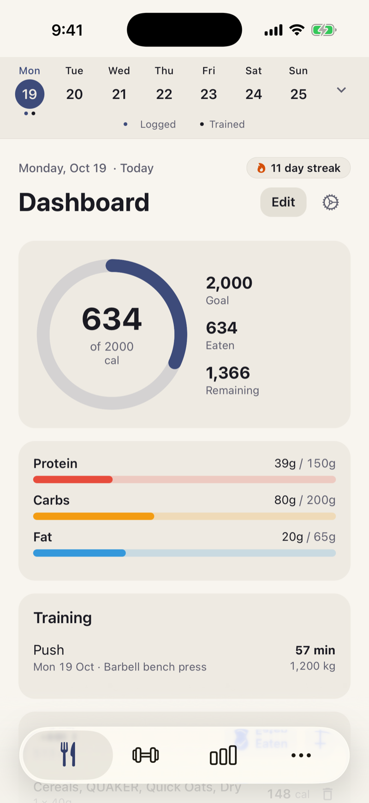</td>
    <td align="center">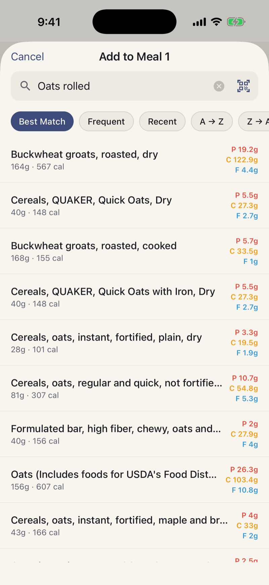</td>
    <td align="center">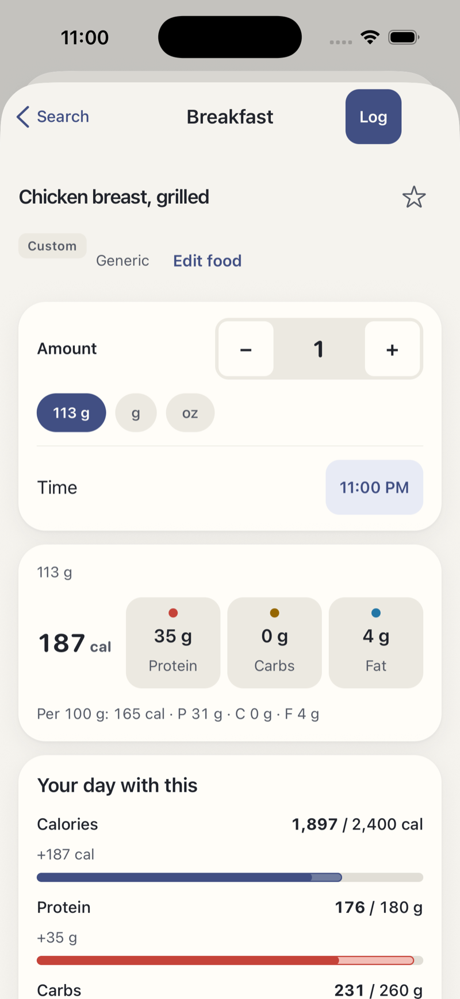</td>
  </tr>
  <tr>
    <td align="center">Dashboard: calorie ring, macros and the day by meal</td>
    <td align="center">Food search: local first, instant results</td>
    <td align="center">Serving picker with nutrients and targets</td>
  </tr>
</table>

### Training

<table>
  <tr>
    <td align="center">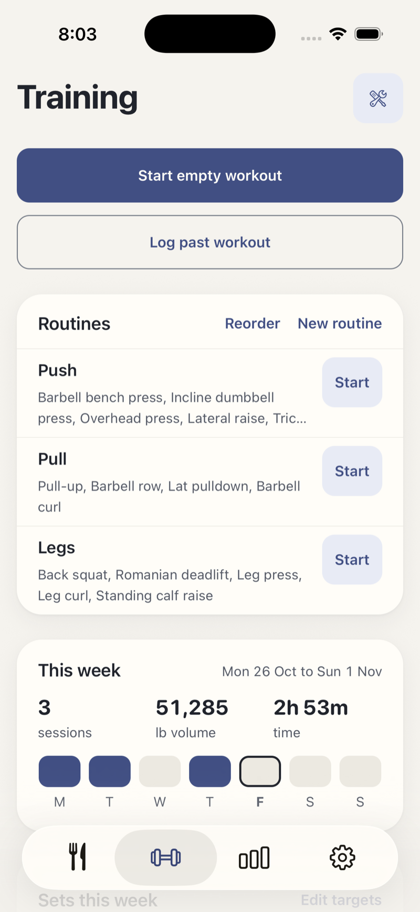</td>
    <td align="center">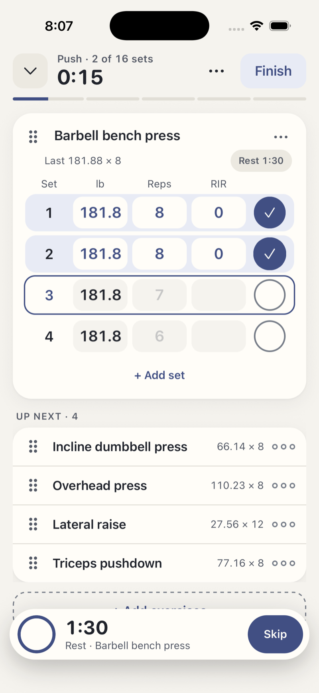</td>
    <td align="center">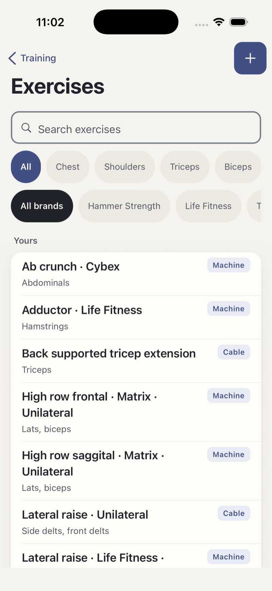</td>
  </tr>
  <tr>
    <td align="center">Weekly summary and workout history</td>
    <td align="center">Live session with rest timer and PR tags</td>
    <td align="center">Exercise library</td>
  </tr>
</table>

### Progress

<table>
  <tr>
    <td align="center">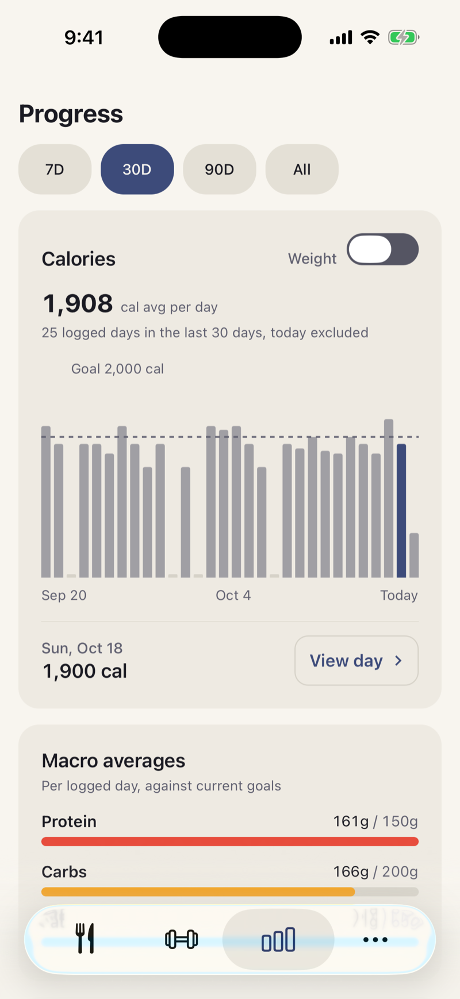</td>
    <td align="center">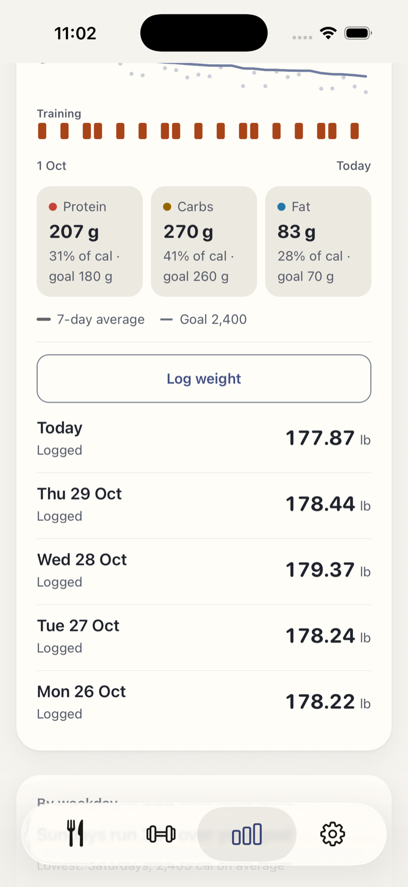</td>
    <td align="center">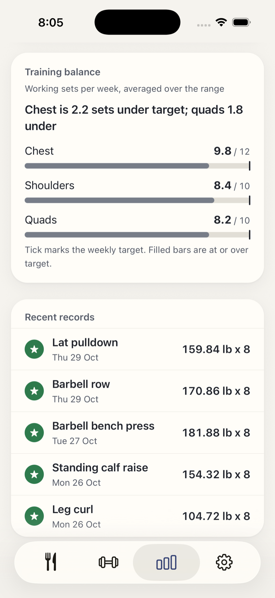</td>
  </tr>
  <tr>
    <td align="center">30 days of calories against the goal</td>
    <td align="center">Weight with a smoothed trend and weekly rate</td>
    <td align="center">Sessions per week and recent records</td>
  </tr>
</table>

### Planning ahead

<table>
  <tr>
    <td align="center">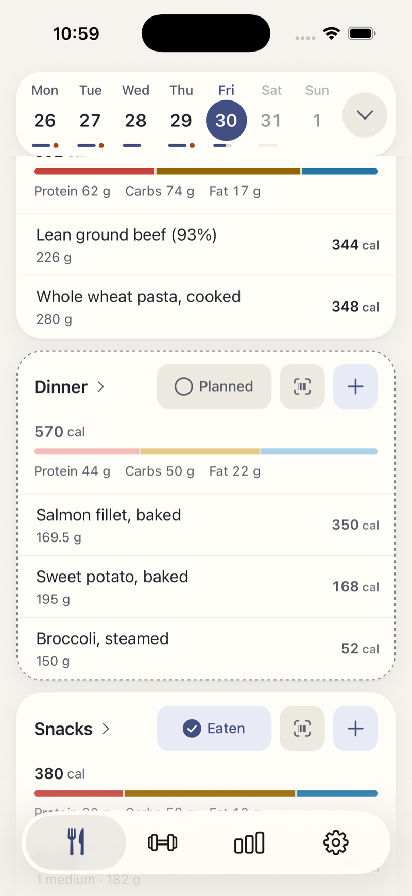</td>
    <td align="center">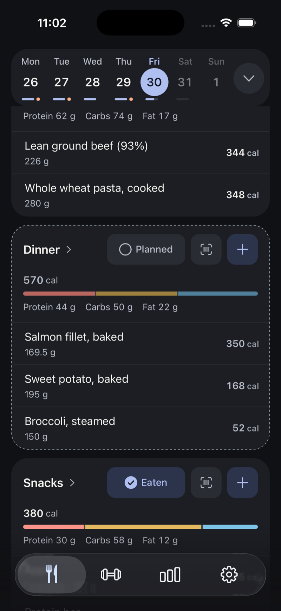</td>
  </tr>
  <tr>
    <td align="center">Plan a meal and it shows as a dashed card and a lighter ring segment</td>
    <td align="center">Planned food only counts once you mark it eaten</td>
  </tr>
</table>

### Dark mode

<table>
  <tr>
    <td align="center">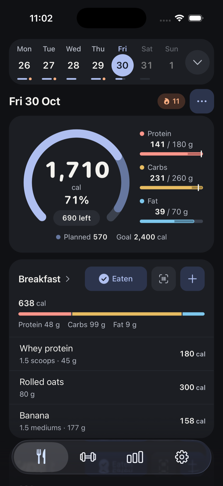</td>
    <td align="center"></td>
    <td align="center"></td>
  </tr>
</table>

## Tech stack

| Area | What I used |
|---|---|
| App | React Native 0.88 and Expo 58 (New Architecture, React Compiler), Expo Router, TypeScript in strict mode |
| Motion and UI | Reanimated 4, a documented design system with light and dark themes, native iOS Live Activities |
| On-device data | SQLite (expo-sqlite) with versioned migrations, AsyncStorage for preferences |
| Backend | Supabase: Postgres, anonymous, email and Apple auth, row-level security |
| iOS integrations | Apple Health (HealthKit), Live Activities, alternate app icons, notifications |
| Quality | Jest (266 test suites), ESLint, strict `tsc`, GitHub Actions CI |
| Data | A bundled food database plus a remote search over about 214k Open Food Facts rows, with relevance tuning |

## Engineering highlights

- **Local-first by design.** The phone is the source of truth. The app opens and logs instantly with no signal and no account wall; every install signs in anonymously and backs up quietly in the background. Rows carry UUIDs and timestamps from day one so sync never required reshaping data. ([ADR 0001](docs/decisions/0001-local-first-storage.md))
- **Deletes that stay deleted.** Deleting a synced row writes a tombstone instead of calling the server, so a delete made offline cannot be undone by a later restore. ([ADR 0004](docs/decisions/0004-tombstone-deletes.md))
- **Honest sync model.** Sync pushes local changes and restore pulls them onto a new phone. There is no live two-device sync, and the docs say so.
- **Security at the database.** Every table is protected by Postgres row-level security, and schema changes ship in numbered migrations that are applied before the client that depends on them.
- **Native iOS features.** A workout Live Activity keeps the rest timer visible on the lock screen, and Apple Watch heart rate is read from Apple Health and stored as a single average and maximum per workout. ([ADR 0028](docs/decisions/0028-rest-mode-and-live-activity.md), [ADR 0029](docs/decisions/0029-heart-rate-from-apple-health.md))
- **Tested and documented.** More than 3,500 tests run in CI, pure logic such as totals, unit conversion, records and sync is kept separate from UI so it can be tested directly, and each architectural choice is written down as a decision record.
- **Built for real use.** User-defined meals instead of fixed slots ([ADR 0002](docs/decisions/0002-user-defined-meals.md)), a 180-exercise library with a guided builder for your own, kg/lb and km/mi units, and CSV export.

## Architecture

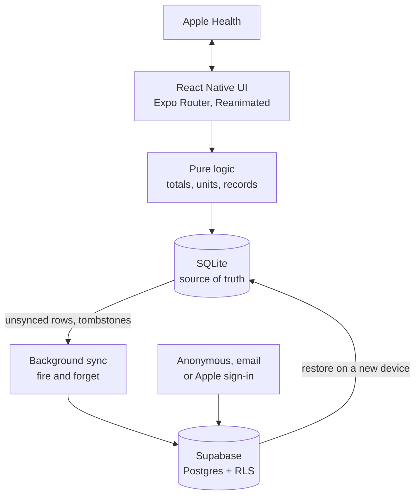

## Decision records

Five of the 60 decision records are published in [`docs/decisions`](docs/decisions/README.md): local-first storage, tombstone deletes, user-defined meals, the workout Live Activity and heart rate from Apple Health.

## Features

**Nutrition**

- Calorie ring, macro bars and a meal-by-meal view of the day
- Your own meals: name them, reorder them, set per-meal targets and reminders
- Fast food search, barcode scanning and custom foods
- Log what you ate or plan what you will, with a week calendar and history

**Training**

- Live workouts with previous sets prefilled and a rest timer
- An exercise library plus a guided builder for your own exercises
- Routines, set types and logging a workout after the fact
- Personal records and weekly sets per muscle group

**Progress**

- Calorie trends, weekly averages and a consistency calendar
- Weight log with a smoothed trend, so one salty dinner doesn't ruin your week
- Estimated energy expenditure from your intake and weight trend
- Training volume, sessions per week and recent records

**Your data**

- Works fully offline and backs up quietly in the background
- No account needed to start; add email or Sign in with Apple to restore on a new phone
- Apple Health sync, CSV export, kg/lb and km/mi

**Make it yours**

  
  
  
  

Pick your Bino: four alternate app icons, switchable in Preferences.

## How it should feel

BinoFit is built for two kinds of people: the everyday tracker who logs between meetings and estimates portions, and the precise one who weighs everything and follows a program. Both want speed, numbers they can trust and an app that never makes them feel bad.

The goals behind every screen:

1. **Log a meal in under 15 seconds.** At most three taps plus a search, and totals you can trust.
2. **Get through a workout without fighting the phone.** One hand, mid-set, sweaty.
3. **See where things are heading.** Trends over weeks, not just today.

And a few lines it doesn't cross:

- **No judging food or bodies.** No "good" or "bad" foods, no red for going over, no shame for a missed day.
- **Acknowledge, don't nag.** It notices a finished workout, a new record or a steady week. It never guilt-trips you or threatens a streak.
- **Calm by default.** Opening the app should feel like a breath, not a task list.

## About

BinoFit is a solo project, designed and built end to end by [Tim Nguyen](https://github.com/nyntim), including the product design, the app, the database and the tests. It runs on device and is not yet released. Questions, feedback or want to see the code? [Open an issue](https://github.com/nyntim/BinoFit/issues) or reach out through my GitHub profile.
