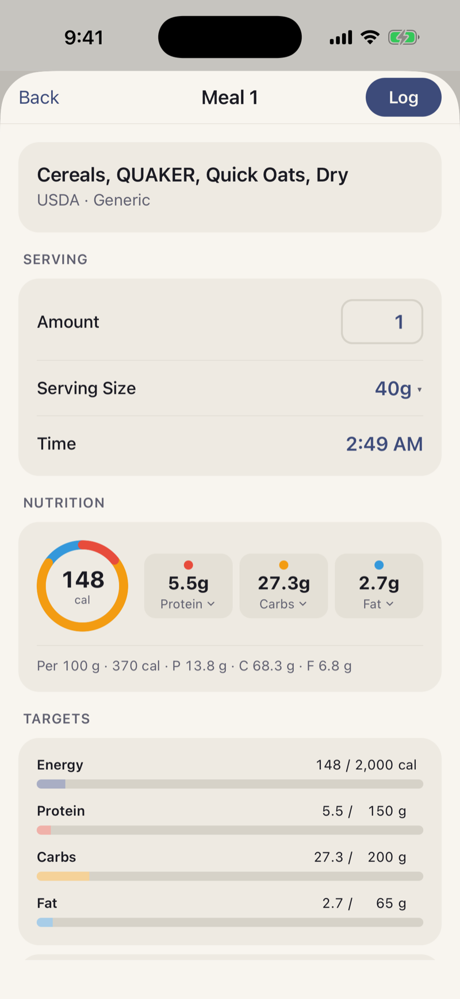
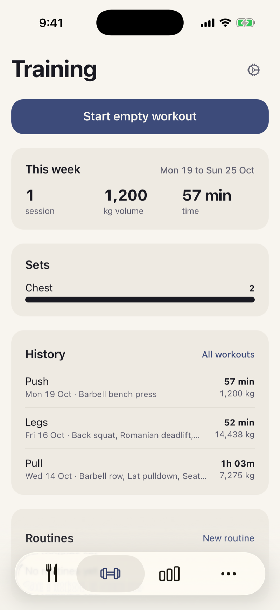
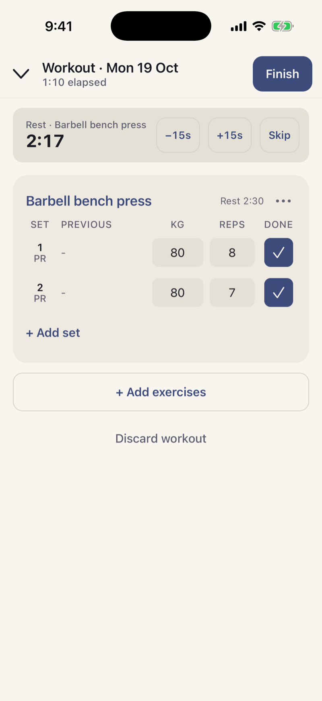
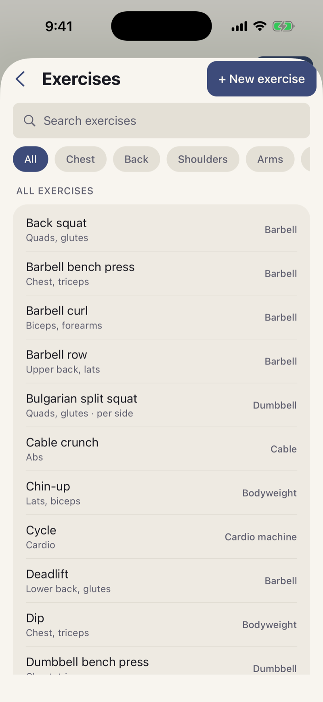
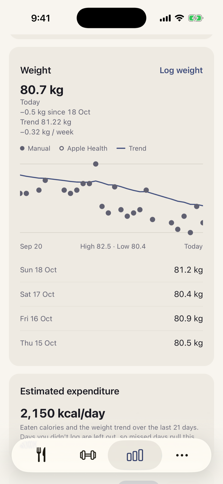
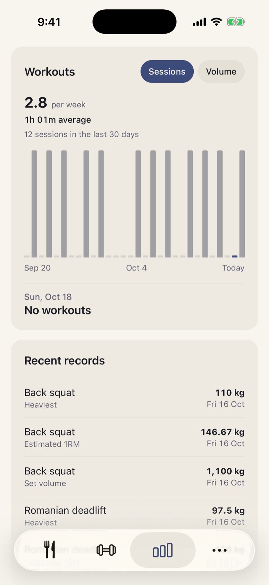
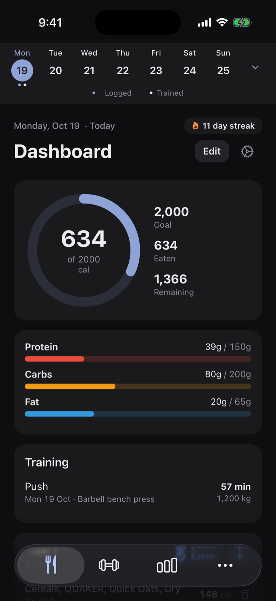
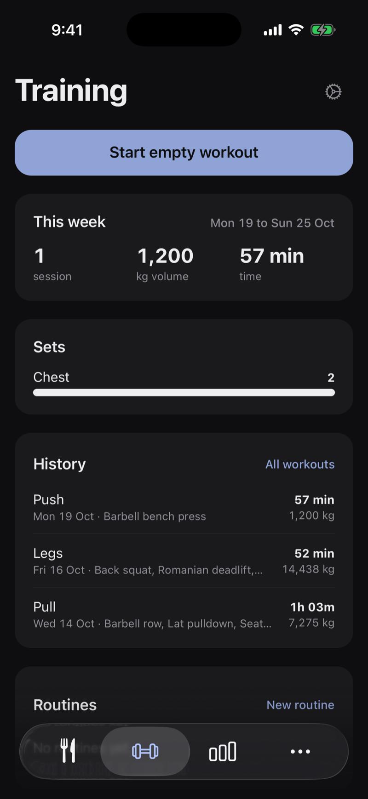
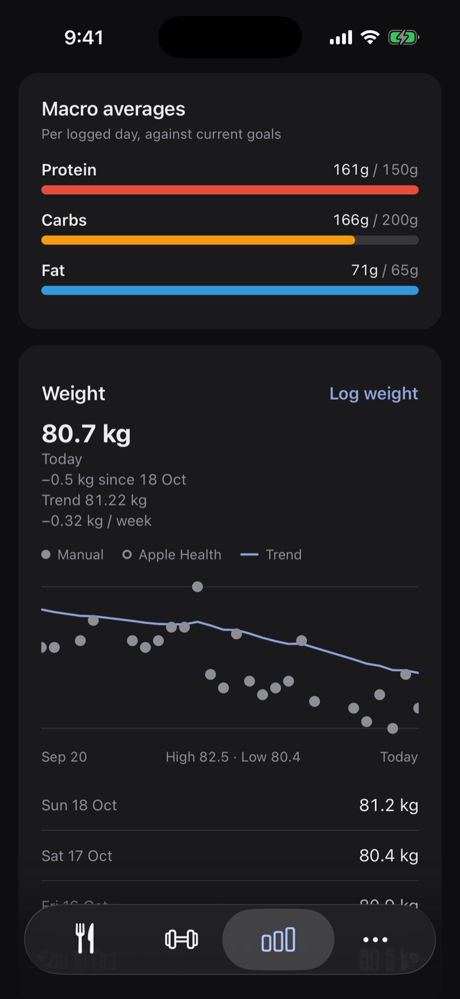

# BinoFit

Nutrition and strength training in one iOS and Android app. Log food, lift, and see how your weight, calories and training line up, with calm, neutral feedback instead of streak guilt.

Built with React Native, Expo and SQLite. Everything works offline and syncs to Supabase in the background.

<p align="center">
  
  
  
</p>
<p align="center">
  
  
  
</p>

<p align="center">
  
  
  
</p>

Dark mode:

<p align="center">
  
  
  
</p>

https://github.com/user-attachments/assets/e92713e6-d205-4a41-8a65-7f805d704cb3

A 40 second walkthrough: a tour of the four tabs with 30 days of sample data, then logging a food from search to the updated dashboard.

## Features

**Nutrition**
- Calorie ring, macro bars and a meal-by-meal day view
- Custom meals: rename, reorder, per-meal targets and daily reminders
- Local-first food search with a remote fallback, custom foods and barcode scanning (Open Food Facts)
- Eaten vs planned logging, week calendar, history and logging streaks

**Training**
- Live workout sessions with a rest timer and notifications
- Exercise library (46 built-in) and a guided custom-exercise builder
- Routines, past-workout logging, set types, previous-performance prefill
- Personal records and weekly muscle-set counts

**Progress**
- Calorie trend, weekly averages and a consistency calendar
- Weight log with a smoothed trend and weekly rate
- Estimated energy expenditure from your intake and weight trend
- Training volume, sessions per week and recent records

**Account and data**
- Anonymous by default; optional email or Apple sign-in with restore on a new device
- Apple Health sync (iOS), CSV export, kg/lb and km/mi units

## Getting started

Requires Node (see `.nvmrc`) and Xcode or Android Studio. The app uses native modules, so it runs as a development build, not Expo Go.

```bash
npm install
npm run ios            # or: npm run android
npm start              # Metro dev server
```

Create a `.env` with `EXPO_PUBLIC_SUPABASE_URL` and `EXPO_PUBLIC_SUPABASE_ANON_KEY` to enable sync.

| Command | Description |
|---|---|
| `npm run ios` / `npm run android` | Build and launch on a simulator or emulator |
| `npm start` | Start the Metro dev server |
| `npm run lint` | ESLint |
| `npm test` | Jest |
| `npm run build:foods` | Rebuild the bundled food database |

## Project structure

```
app/          Expo Router routes: (tabs), onboarding, workout/, food and account screens
components/   UI, grouped by feature (dashboard, workouts, progress, settings, auth)
lib/          Data and logic: SQLite, sync, auth, workouts, progress (pure functions where possible)
hooks/        Custom React hooks
context/      React context providers
constants/    Theme palette and fonts
supabase/     Database schema and row-level security
docs/         Phase plans and approved design mockups
```

## Tech stack

- React Native 0.81 and Expo 54, New Architecture, React Compiler
- Expo Router 6 (file-based, typed routes)
- expo-sqlite for on-device data, AsyncStorage for preferences
- Supabase (auth, Postgres, row-level security) for sync and backup
- TypeScript (strict), Jest, GitHub Actions CI

## Contributing and docs

- `CLAUDE.md` and `AGENTS.md`: architecture notes and conventions
- `PRODUCT.md`, `DESIGN.md`: product voice and design system
- `docs/`: per-phase plans (foundation through progress)

## License

Copyright (c) 2026 BinoFit. All rights reserved. See `LICENSE`.
