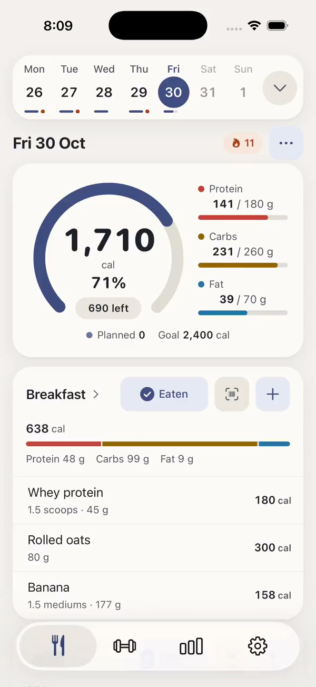

  

<h1 align="center">BinoFit</h1>

<b>The tool for the optimal lifter</b>

  Nutrition and strength training in one iOS app. 
  Log food, lift, and see how your weight, calories and training line up.

  
  
  

---

Most trackers make you pick a side: a food logger that ignores your training, or a workout log that has no idea what you ate. BinoFit puts both in one place so you can actually see how they affect each other, and it does it without the streak guilt, red numbers and nagging that make people quit tracking.

> This repo is a showcase. The app's source code is private; here you'll find what BinoFit does, how it looks and why it's built the way it is.

## Demo

  

A 40 second walkthrough: a tour of the Nutrition, Training and Progress tabs with 30 days of sample data, then logging a food from search to the updated dashboard.

## Screenshots

### Nutrition

<table>
  <tr>
    <td align="center"></td>
    <td align="center"></td>
    <td align="center"></td>
  </tr>
  <tr>
    <td align="center">Dashboard: calorie ring, macros and the day by meal</td>
    <td align="center">Food search: local first, instant results</td>
    <td align="center">Serving picker with nutrients and targets</td>
  </tr>
</table>

### Training

<table>
  <tr>
    <td align="center"></td>
    <td align="center"></td>
    <td align="center"></td>
  </tr>
  <tr>
    <td align="center">Weekly summary and workout history</td>
    <td align="center">Live session with rest timer and PR tags</td>
    <td align="center">Exercise library</td>
  </tr>
</table>

### Progress

<table>
  <tr>
    <td align="center"></td>
    <td align="center"></td>
    <td align="center"></td>
  </tr>
  <tr>
    <td align="center">30 days of calories against the goal</td>
    <td align="center">Weight with a smoothed trend and weekly rate</td>
    <td align="center">Sessions per week and recent records</td>
  </tr>
</table>

### Dark mode

<table>
  <tr>
    <td align="center"></td>
    <td align="center"></td>
    <td align="center"></td>
  </tr>
</table>

## Features

**Nutrition**

- Calorie ring, macro bars and a meal-by-meal view of the day
- Your own meals: name them, reorder them, set per-meal targets and reminders
- Fast food search, barcode scanning and custom foods
- Log what you ate or plan what you will, with a week calendar and history

**Training**

- Live workouts with previous sets prefilled and a rest timer
- An exercise library plus a guided builder for your own exercises
- Routines, set types and logging a workout after the fact
- Personal records and weekly sets per muscle group

**Progress**

- Calorie trends, weekly averages and a consistency calendar
- Weight log with a smoothed trend, so one salty dinner doesn't ruin your week
- Estimated energy expenditure from your intake and weight trend
- Training volume, sessions per week and recent records

**Your data**

- Works fully offline and backs up quietly in the background
- No account needed to start; add email or Sign in with Apple to restore on a new phone
- Apple Health sync, CSV export, kg/lb and km/mi

**Make it yours**

  
  
  
  

Pick your Bino: four alternate app icons, switchable in Preferences.

## How it should feel

BinoFit is built for two kinds of people: the everyday tracker who logs between meetings and estimates portions, and the precise one who weighs everything and follows a program. Both want speed, numbers they can trust and an app that never makes them feel bad.

The goals behind every screen:

1. **Log a meal in under 15 seconds.** At most three taps plus a search, and totals you can trust.
2. **Get through a workout without fighting the phone.** One hand, mid-set, sweaty.
3. **See where things are heading.** Trends over weeks, not just today.

And a few lines it doesn't cross:

- **No judging food or bodies.** No "good" or "bad" foods, no red for going over, no shame for a missed day.
- **Acknowledge, don't nag.** It notices a finished workout, a new record or a steady week. It never guilt-trips you or threatens a streak.
- **Calm by default.** Opening the app should feel like a breath, not a task list.

## Built with

- React Native and Expo, written in TypeScript
- On-device SQLite, so everything is instant and works offline
- Cloud sync and backup, with sign-in by email or Apple
- Native iOS integrations: Apple Health, Live Activities and alternate app icons

## About

BinoFit is designed and built by [Tim Nguyen](https://github.com/nyntim). Questions, feedback or want to try it? [Open an issue](https://github.com/nyntim/BinoFit/issues).
