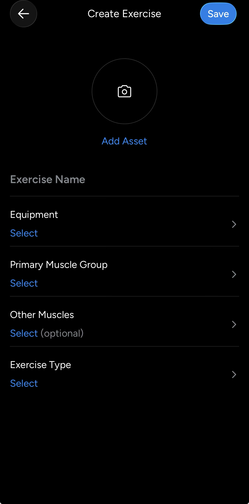

# Competitor references

Screenshots of other training apps, kept as inspiration for BinoFit. These are inspiration only; see `PRODUCT.md` and `DESIGN.md` for direction and `docs/decisions/0007-exercise-library-and-builder.md` for the builder decision.

## Create Exercise (custom exercise builder)

File: `create-exercise.png`. Dark theme, Android.

### What it does

A single form screen for creating a custom exercise. Header has a circular back button, the title "Create Exercise" and a pill Save button. Below the header:

1. **Add Asset**: circular camera placeholder for a photo or video of the exercise.
2. **Exercise Name**: free text input.
3. **Equipment**: row that opens a picker (shows "Select" until chosen).
4. **Primary Muscle Group**: row that opens a picker.
5. **Other Muscles**: row that opens a picker, marked "(optional)".
6. **Exercise Type**: row that opens a picker (for example weight and reps, duration, distance).

Each row is a label over a blue "Select" value with a chevron, separated by hairline dividers.

### Notes for BinoFit

- Same fields as our guided builder (`app/workout/new-exercise.tsx`, `lib/workouts/exercise-builder.ts`): name, equipment, primary muscle, other muscles (optional), exercise type.
- Difference: the competitor uses one flat form with a picker per row. We use a guided step-by-step flow with a review screen (`docs/design/training/Builder.dc.html`, `BuilderReview.dc.html`). Their form is quicker for users who know what they want, ours is easier on first use.
- Save stays enabled-looking before the form is valid. Ours disables or validates per step via `isStepValid`.
- The photo/video asset is not in our model. Skipped for now.
- Mirrors the "Other Muscles (optional)" idea in our secondary muscles step, which uses Skip as its primary label.
